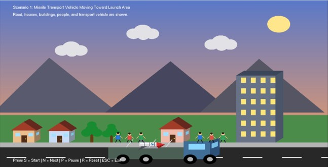
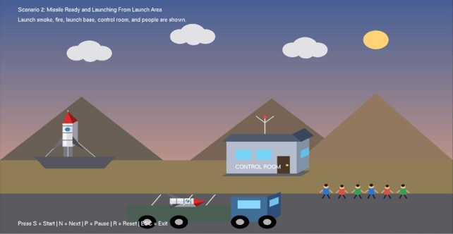
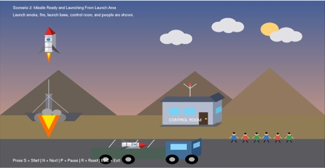
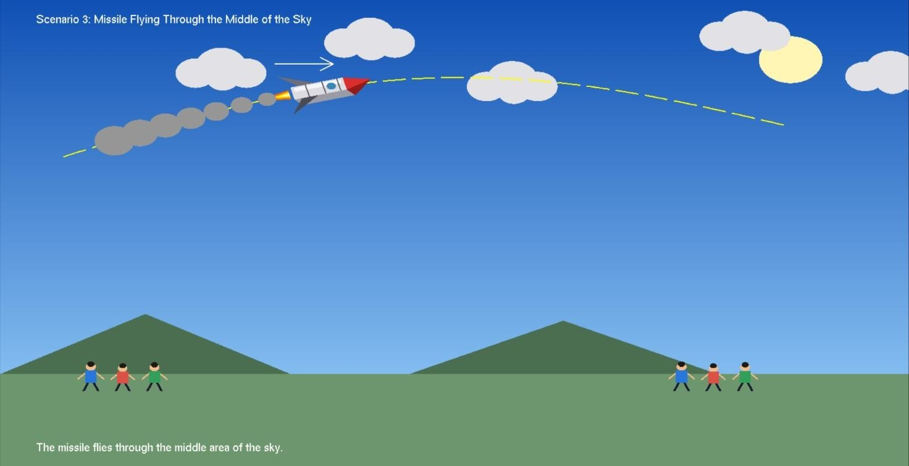
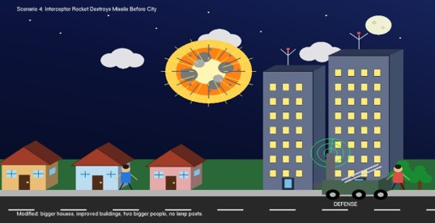
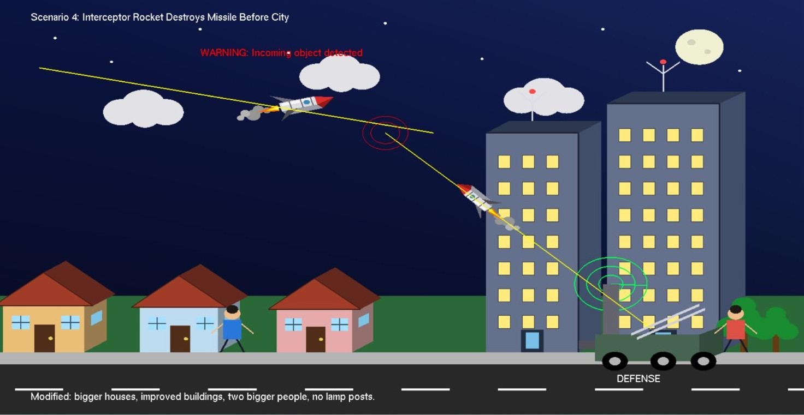

# Computer Graphics Missile Project

A C++ computer-graphics project containing five independent Code::Blocks applications. Four applications demonstrate individual missile-related scenes, while the **CG Final Project** application combines the four scenarios into one animated program.

The scenes are drawn programmatically with OpenGL primitives and animated using FreeGLUT timer callbacks. The supplied screenshots are included in the `screenshots/` directory.

## Project Overview

The project demonstrates 2D computer graphics, object composition, transformations, keyboard interaction, and timer-driven animation through four visual scenarios:

1. **Missile transport** — a vehicle carries a missile toward a launch area.
2. **Missile launch** — a missile launches from a prepared launch area.
3. **Missile flight** — a missile follows a curved path across the sky.
4. **Missile interception** — a defense system tracks and intercepts an incoming missile.

The combined application lets the user move through all four scenarios in sequence. The other four Code::Blocks projects run the corresponding scenes individually.

## Objectives

- Demonstrate 2D drawing using OpenGL.
- Compose scenes from geometric shapes and graphical objects.
- Animate object movement using timer callbacks.
- Apply basic transformations such as translation, rotation, and scaling.
- Handle keyboard input to start, pause, reset, and navigate animations.
- Present related scenes both as standalone programs and as one combined application.

## Key Features

- Five independent Code::Blocks project files.
- One combined application containing four scenarios.
- Four standalone scene applications.
- Programmatically drawn roads, buildings, landscapes, clouds, vehicles, missiles, launch equipment, radar, smoke, and explosion effects.
- Timer-based animation using FreeGLUT.
- Keyboard controls for animation playback.
- Six supplied visual references in `screenshots/`.

## Technologies Used

| Technology | Purpose |
|---|---|
| C++ | Application logic and drawing routines |
| OpenGL | 2D graphics rendering |
| GLU | Orthographic projection setup |
| FreeGLUT / GLUT | Window creation, keyboard callbacks, and timer-driven animation |
| GCC / MinGW-w64 | C++ compiler toolchain |
| Code::Blocks | Project and build environment |

The source uses the legacy fixed-function OpenGL pipeline (`glBegin`/`glEnd`) and includes the Windows header `windows.h`. The supplied Code::Blocks projects are configured for a GCC/MinGW Windows toolchain.

## Project Structure

```text
Computer-Graphics-Missile-Project/
├── CG Final Project/
│   ├── CG Final Project.cbp
│   └── main.cpp
├── Missile Flying Scene/
│   ├── Missile Flying Scene.cbp
│   └── main.cpp
├── Missile Interception Scene/
│   ├── Missile Interception Scene.cbp
│   └── main.cpp
├── Missile Launch Scene/
│   ├── Missile Launch Scene.cbp
│   └── main.cpp
├── Missile Transport Scene/
│   ├── Missile Transport Scene.cbp
│   └── main.cpp
├── screenshots/
│   ├── 01-missile-transport.jpg
│   ├── 02-missile-launch-ready.jpg
│   ├── 03-missile-launch.jpg
│   ├── 04-missile-interception-overview.jpg
│   ├── 05-missile-flight.jpg
│   └── 06-missile-interception-sequence.jpg
├── .gitignore
└── README.md
```

Each project folder contains its own `main.cpp` and `.cbp` file. Each source file has its own `main()` function, so build and run one project at a time.

## Requirements

- Windows environment.
- Code::Blocks with a working GCC/MinGW-w64 toolchain.
- FreeGLUT development files compatible with the selected compiler architecture:
  - FreeGLUT headers, including `GL/glut.h`.
  - The FreeGLUT import/link library.
  - The matching FreeGLUT runtime DLL, available beside the built executable or through the system `PATH`.
- OpenGL and GLU libraries. The Code::Blocks projects link `opengl32` and `glu32`.
- Windows libraries linked by the project files: `winmm` and `gdi32`.

The original project does not pin compiler or library versions. Use a consistent 32-bit or 64-bit FreeGLUT package and MinGW toolchain; the supplied project settings were originally written for a 64-bit MinGW-w64 installation.

## Installation and Build

### 1. Install the toolchain

1. Install Code::Blocks with the MinGW compiler toolchain.
2. Install a FreeGLUT development package that matches the MinGW architecture.
3. Configure the FreeGLUT include and library directories in your compiler/toolchain settings if they are not already in the default search paths.
4. Make sure the matching FreeGLUT runtime DLL can be found when the executable starts. Do not commit the DLL or other third-party binaries unless you have the right to redistribute them.

### 2. Open a project

Open the `.cbp` file for the scene you want to run:

| Application | Code::Blocks project file |
|---|---|
| Combined four-scenario application | `CG Final Project/CG Final Project.cbp` |
| Missile transport | `Missile Transport Scene/Missile Transport Scene.cbp` |
| Missile launch | `Missile Launch Scene/Missile Launch Scene.cbp` |
| Missile flight | `Missile Flying Scene/Missile Flying Scene.cbp` |
| Missile interception | `Missile Interception Scene/Missile Interception Scene.cbp` |

### 3. Build and run

1. Open the selected `.cbp` file in Code::Blocks.
2. Confirm that the compiler can find the FreeGLUT headers and libraries.
3. Choose the `Debug` or `Release` build target.
4. Use **Build and Run** in Code::Blocks.
5. If Windows reports that `freeglut.dll` is missing, install or locate the matching runtime DLL and make it available beside the generated executable or through `PATH`.

The project files link the following libraries: `freeglut`, `opengl32`, `glu32`, `winmm`, and `gdi32`.

## Controls and Usage

### Combined application — `CG Final Project`

| Key | Action |
|---|---|
| `S` | Start the current scenario's animation |
| `P` | Pause or resume the animation |
| `N` | Move to the next scenario |
| `R` | Reset the current scenario |
| `Esc` | Exit the application |

The combined application cycles through the four scenarios in this order: transport → launch → flight → interception → transport.

### Standalone scene applications

| Key | Action |
|---|---|
| `S` | Start the animation |
| `P` | Pause or resume the animation |
| `R` | Reset the current scene |
| `Esc` | Exit the application |

The standalone programs each run one scene and do not use the `N` next-scenario control.

## Screenshots

### Missile transport



### Missile launch





### Missile flight



### Missile interception





## Dataset and External Assets

No external dataset is required. The scene graphics are drawn in the C++ source code. The six JPG files are documentation screenshots; the source code does not load them as runtime textures or data files.

## Results and Outputs

When built and run with the required Windows graphics toolchain, each application opens a graphics window and displays its corresponding animated scene. The combined application provides access to all four scenarios.

## Build Verification Status

The project files and source structure were reviewed during GitHub preparation. A native Windows build was **not performed in the preparation environment**, because Windows, Code::Blocks, MinGW-w64, and the FreeGLUT development package were not available there. Successful compilation on your machine therefore still depends on installing and configuring the listed dependencies.

## Author

**MD. Mosaddek Muttakey**

Credited as the author in the supplied project README.

## License

No `LICENSE` file or explicit open-source license was included in the supplied project. The original README describes the work as an educational project, but that statement does not by itself grant permission to reuse, modify, or redistribute the code. A license should be added only with the copyright holder's approval.
